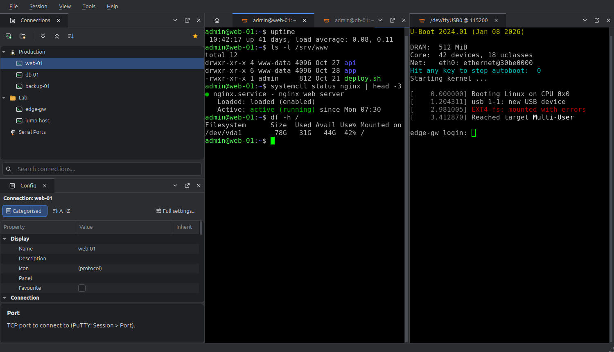
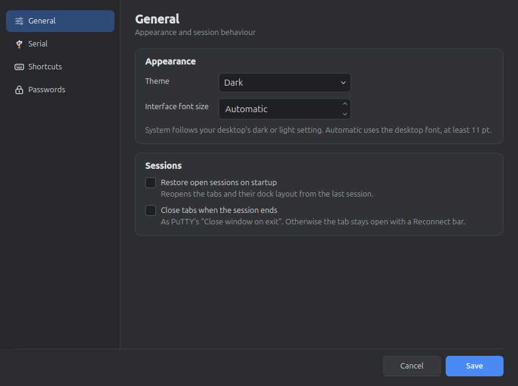
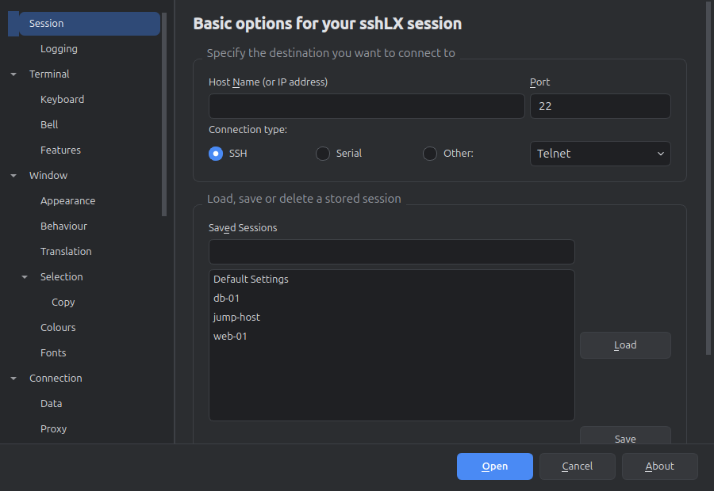
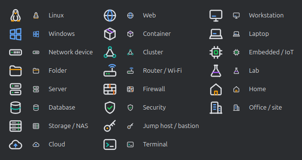

<p align="center">
  
</p>

<h1 align="center">sshLX</h1>

<p align="center">
  A tabbed, session-managed SSH, Telnet and serial client for Linux,<br>
  built on the <b>PuTTY 0.85</b> core with a modern <b>Qt 6</b> interface.
</p>

<p align="center">
  
</p>

## Features

- **Connection tree:** folders, favourites, search and drag & drop. Your existing PuTTY sessions appear automatically.
- **Group icons:** 22 line icons that follow the dark and light themes, for folders and connections (servers, databases, cloud, network gear, containers, lab, sites and more).
- **Property grid** to edit connections and folders, with **folder inheritance** (set a username or proxy once per folder).
- **Dockable, splittable tabs:** side by side, stacked or floating (detach a tab, re-attach it from its window or the View menu). The layout and open tabs are restored on the next start.
- **Update check:** Help → Check for Updates asks GitHub for the latest release.
- **Every PuTTY option** stays available, through PuTTY's complete settings dialog.
- **PuTTY compatible:** sessions are stored in PuTTY's own format, so `putty` keeps working with them.
- **Serial hot-plug:**
  - plugging in a device offers to connect;
  - the line speed is detected automatically (9600 for most network consoles, 115200 for most boards);
  - per-device rules (*Always connect / Never ask*) survive renumbering;
  - tabs reconnect when their device comes back;
  - a permission error explains the `dialout` group fix.
- **Terminal mouse:** selecting copies, right click pastes (or shows the menu, or extends the selection as in PuTTY: Options → Terminal), and Ctrl + right click or the Menu key always shows the menu. Pasting several lines asks first.
- **Paste Configuration:** sends a config to a device line by line, waiting for the prompt after each. On an error, a question or silence it pauses in the tab so you can amend the line, skip it or answer, then carries on from there. Handles `--More--` pagers and Cisco banners, and takes text from the clipboard or a file.
- **Terminal menu:** Select All, Find in Terminal (Ctrl+Shift+F), Save and Print Terminal Text, Clear Terminal, your own macros, Change Terminal Title, and **links** that open with Ctrl + click.
- **Keyword highlighting:** colour words or regular expressions in live output, each with its own colours, in priority order. Select text and choose Add Keyword, or manage the list in Options → Highlighting. Ctrl+Shift+H toggles it.
- **File transfer:** right-click an SSH connection or tab and choose **File Transfer** for a two-pane file manager in its own tab: drag files either way, whole folders included, with a queue, a toolbar for rename, delete and new folder on either side, and a filter. It logs in the same way as the connection, saved passwords included. Devices without SFTP, such as many switches, get SCP instead: type the remote path and send or fetch one file at a time.
- **Credentials Manager:** shared logins (user name, password, private key and its passphrase) linked to connections or whole folders. Change one and every linked connection uses it at its next login. Secrets are kept only in the system keyring. For prompts inside a session, such as `sudo`, use **Send Saved Password** in the terminal menu.
- **Command Window** (View menu, Ctrl+Shift+B): type a command once and send it to the current tab, the visible tabs, all tabs or a chosen few. Several lines go out one at a time, and each tab pauses on its own if its device complains.
- **Button bar:** your macros as a row of buttons, with folders as drop-down menus. Move it to the top or bottom edge. Right-click a button to run it on the Command Window's tabs. A macro can also run a Python script.
- **Logon actions:** right-click a connection or folder for steps that run after connecting: wait for some text, then send a reply or a saved password, such as `enable` followed by its password. Passwords go only to a line that looks like a password prompt.
- **Named workspaces** (View → Workspaces): save the open tabs and their layout under a name, and reopen them, replacing the open tabs or joining them.
- **Xmodem, Ymodem and Zmodem** in the terminal menu, for ROM monitors, boot loaders and other devices with no SFTP, on serial, SSH or Telnet. Starting `sz` or `rz` on the remote side offers a Zmodem transfer, and nothing is saved until you accept.
- **TFTP server** (Tools menu) for switches and routers that fetch images and configurations. It serves one folder, read-only unless you allow uploads.
- **Python scripting** (Tools → Run Script): drive tabs from a script, wait for output and read the screen, in the system's own Python. Scripts can use saved passwords but never see them. See [docs/SCRIPTING.md](docs/SCRIPTING.md).
- **In-tab prompts** for host keys, weak crypto and log files, with a **Reconnect** bar when a session ends.
- **Opt-in password storage** in the system keyring (GNOME Keyring / KWallet), never in a file.
- **Dark and light themes,** configurable shortcuts and an interface font size setting.

| Options | PuTTY settings, restyled |
|---|---|
|  |  |

<p align="center"></p>

## Install

Download the packages from the [latest release](https://github.com/ClaudiuJitea/sshLX/releases/latest).

```sh
sudo apt install ./sshlx_0.7.3_amd64.deb      # Debian / Ubuntu
# or, on any distribution:
chmod +x sshLX-0.7.3-x86_64.AppImage && ./sshLX-0.7.3-x86_64.AppImage
```

Serial ports need membership of the `dialout` group (`uucp` on Arch): `sudo usermod -aG dialout $USER`.

## Build from source

You need CMake ≥ 3.21, a C/C++17 compiler, Perl, Ninja and Qt ≥ 6.2 (Widgets, DBus), plus `libsecret-1-dev` for the system keyring. Saved passwords and the Credentials Manager need it; to build without the keyring, pass `-DSSHLX_KEYCHAIN=OFF`.

```sh
git clone https://github.com/ClaudiuJitea/sshLX.git
cd sshLX
tools/fetch-putty.sh              # PuTTY 0.85 source into ../putty-0.85, checksum-verified
cmake -S . -B build -G Ninja
cmake --build build
./build/sshLX
```

`tools/package.sh` builds the `.deb` and the AppImage into `dist/`.

The PuTTY tree is only ever read. Its sha256 manifest is checked by `tools/verify-putty-untouched.sh` (also `cmake --build build --target verify-putty`).

## How it works

sshLX doesn't launch `putty`. PuTTY's own code is compiled in, unchanged:
- the SSH, Telnet, Rlogin, SUPDUP, Raw and serial back ends;
- the terminal emulator and cryptography;
- configuration and session storage.

sshLX replaces only the GTK front end, with a small C engine API and a Qt UI. It adds one back end of its own: **Local shell** (File → New Local Shell, Ctrl+Shift+T), your login shell in a pseudo-terminal on this machine. One PuTTY file has a documented override that fixes three serial bugs. See [ARCHITECTURE-NOTES.md](ARCHITECTURE-NOTES.md) and [PUTTY-OVERRIDES.md](PUTTY-OVERRIDES.md).

| Data | Location |
|---|---|
| Sessions | PuTTY's `~/.putty/sessions` (or `~/.config/putty`) |
| Tree, folders, inheritance | `~/.config/sshLX/connections.json` |
| Layout, shortcuts, options, macros | `~/.config/sshLX/sshLX.conf` |
| Workspaces | `~/.config/sshLX/workspaces/` |
| Scripts menu | `~/.config/sshLX/scripts/` |
| Passwords (opt-in) | system keyring only |

## Licence and credits

sshLX is released under the [MIT licence](LICENSE).

- **PuTTY** is copyright 1997-2025 Simon Tatham and the PuTTY authors, and is used under the MIT licence ([LICENCE](third_party/putty/LICENCE)). sshLX is not PuTTY and isn't endorsed by its authors.
- **Libraries,** all linked dynamically:
  - Qt 6 (LGPL-3.0);
  - [Qt Advanced Docking System](https://github.com/githubuser0xFFFF/Qt-Advanced-Docking-System) 4.4.1 (LGPL-2.1). Small fixes are applied in `cmake/patches/`.
  - [QtKeychain](https://github.com/frankosterfeld/qtkeychain) 0.15.0 (BSD-3-Clause);
  - libudev (LGPL-2.1), loaded at runtime.
- **Optional at runtime:** Python 3, for scripts. It is not linked in.
